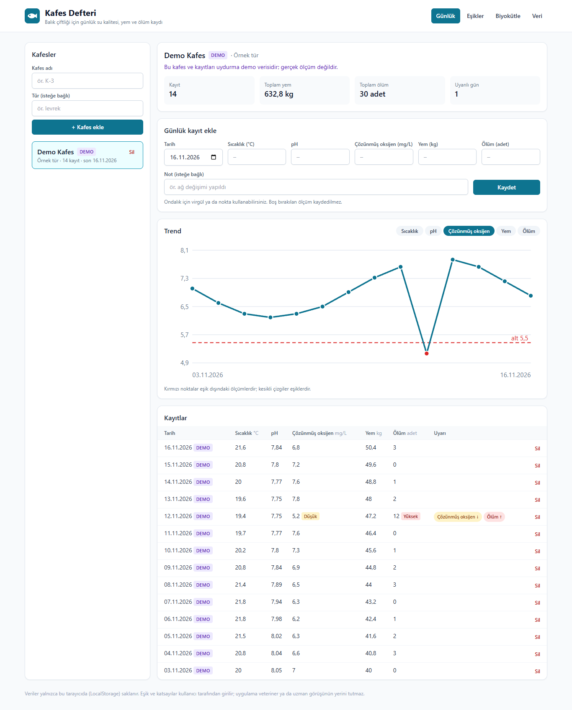
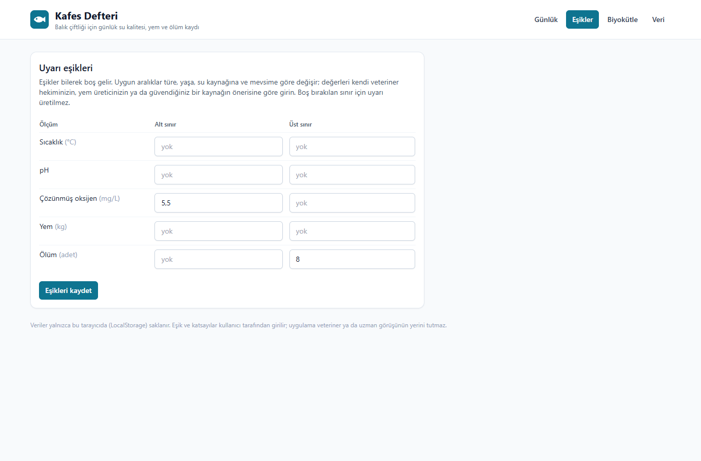
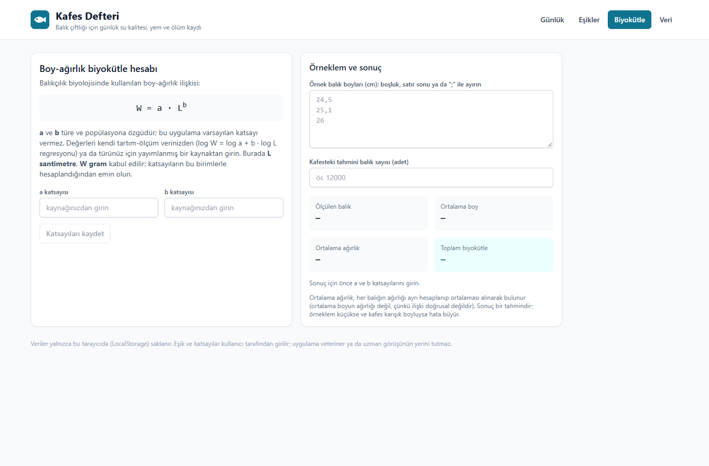
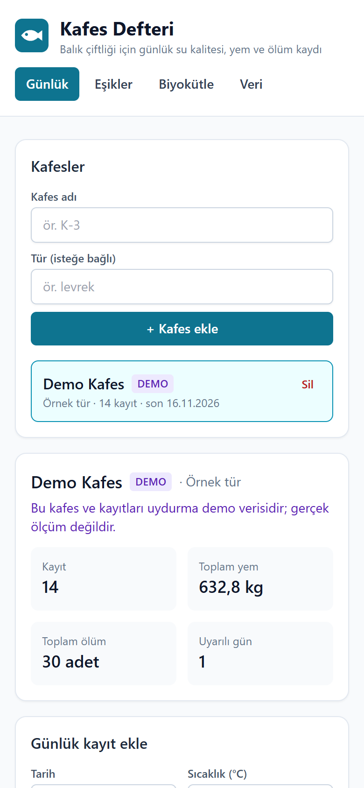

# Kafes Defteri

Balık çiftliği (deniz kafesi ya da havuz) için tarayıcıda çalışan bir günlük. Her kafes için su sıcaklığı, pH,
çözünmüş oksijen, verilen yem ve ölüm adedi günlük olarak kaydedilir. İşletmecinin kendi belirlediği eşiklerin
dışına çıkan ölçümler rozetle işaretlenir, seçilen ölçüm bir trend grafiğinde izlenir. Ayrıca örnek balık
boylarından boy-ağırlık ilişkisiyle (W = a·L^b) kafesteki toplam biyokütle tahmin edilir.

Veriler sunucuya gitmez, yalnızca kullanıcının tarayıcısında (LocalStorage) saklanır.

**Canlı sürüm:** https://kafes-defteri.netlify.app/  
**Kaynak kod:** https://github.com/Onder-MuratCan/kafes-defteri



> Ekran görüntüsündeki kafes ve kayıtlar uygulamanın ürettiği **Demo** verisidir, gerçek ölçüm değildir. Uyarı
> rozetlerini göstermek için Eşikler ekranına örnek olarak girilen değerler (çözünmüş oksijen alt sınırı 5,5 mg/L,
> ölüm üst sınırı 8 adet) bir öneri değildir.

## Neden?

Küçük ve orta ölçekli çiftliklerde günlük ölçümler çoğu zaman kâğıt deftere ya da dağınık tablolara yazılıyor.
Kafes Defteri bu kaydı telefondan da girilebilen tek bir ekrana topluyor ve kötüye giden bir ölçümü (ör. oksijen
düşüşü, ölüm artışı) tablo içinde kaybolmadan gösteriyor.

## Özellikler

- **Kafes yönetimi:** Kafes ekleme ve silme (silinen kafesin kayıtları da silinir), aynı adla ikinci kafes engellenir.
- **Günlük kayıt:** Tarih, sıcaklık (°C), pH, çözünmüş oksijen (mg/L), yem (kg), ölüm (adet) ve not. Ölçümlerin
  hepsi isteğe bağlıdır; en az biri girilmelidir. Ondalık için virgül ya da nokta kullanılabilir.
- **Doğrulama:** Sayı olmayan değer, negatif yem/oksijen/ölüm, 0–14 dışındaki pH ve küsuratlı ölüm adedi reddedilir.
- **Eşik uyarıları:** Her ölçüm için alt ve üst sınır kullanıcı tarafından girilir. Sınır dışı değerler tabloda
  “Düşük / Yüksek” rozetiyle, kafes listesinde son kaydın uyarılarıyla, grafikte kırmızı noktayla gösterilir.
- **Trend grafiği:** Seçilen ölçümün zaman içindeki değişimi; eşikler kesikli çizgiyle çizilir. Grafik
  kütüphanesiz, saf SVG ile yazıldı.
- **Biyokütle hesabı:** W = a·L^b. Örnek boylar (cm) girilir, her balığın ağırlığı ayrı hesaplanıp ortalaması
  alınır, tahmini balık sayısıyla çarpılarak toplam biyokütle (kg) bulunur.
- **Veri:** JSON olarak dışa/içe aktarma, demo verisi yükleme/kaldırma, tüm verileri silme.
- **Mobil uyumlu** arayüz, tamamen Türkçe.

### Bilerek boş bırakılanlar

Uygun su kalitesi aralıkları ve boy-ağırlık katsayıları türe, yaşa, su kaynağına ve mevsime göre değişir.
Kaynağı doğrulanmamış bir sayıyı varsayılan olarak koymak kullanıcıyı yanıltabileceği için **eşikler ve a, b
katsayıları boş gelir**; kullanıcı kendi veteriner hekiminin, yem üreticisinin ya da yayımlanmış bir kaynağın
değerlerini girer. Demo verisi her yerde **Demo** etiketiyle gösterilir.

## Ekranlar

| Eşikler | Biyokütle | Mobil |
|---|---|---|
|  |  |  |

## Kurulum

Gerekenler: [Node.js](https://nodejs.org/) 18 ya da üstü.

```bash
git clone https://github.com/Onder-MuratCan/kafes-defteri.git
cd kafes-defteri
npm install
npm run dev
```

Tarayıcıda `http://localhost:5173` açılır. Üretim derlemesi için:

```bash
npm run build     # çıktı: dist/
npm run preview   # derlenmiş sürümü yerelde dener
```

### Yayına alma (Netlify)

Depodaki `netlify.toml` derleme komutunu (`npm run build`) ve yayın klasörünü (`dist`) tanımlar. Netlify'da
“Add new site → Import an existing project” ile GitHub deposu seçildiğinde ek ayar gerekmez.

## Kullanılan teknolojiler

| Teknoloji | Ne için |
|---|---|
| React 18 | Bileşen tabanlı arayüz, durum yönetimi (`useState`, `useEffect`, `useMemo`) |
| Vite 5 | Geliştirme sunucusu ve üretim derlemesi |
| Tailwind CSS 3 | Yardımcı sınıflarla stil, `@apply` ile ortak bileşen sınıfları |
| LocalStorage | Tarayıcıda kalıcı veri saklama |
| SVG | Bağımlılıksız trend grafiği |
| Netlify | Canlı yayın |

## Proje yapısı

```
src/
  App.jsx                 sekmeler, uygulama durumu, LocalStorage'a kayıt
  lib.js                  veri modeli, sayı ayrıştırma, eşik kontrolü, W = a·L^b, demo verisi
  components/
    CageList.jsx          kafes ekleme/silme/seçme, son kaydın uyarıları
    LogView.jsx           günlük kayıt formu, özet kartları, trend, kayıt tablosu
    TrendChart.jsx        SVG çizgi grafiği
    ThresholdsView.jsx    eşik formu
    BiomassView.jsx       boy-ağırlık biyokütle hesabı
    DataView.jsx          demo, JSON yedekleme, tüm verileri silme
    Badges.jsx            Düşük/Yüksek/Demo rozetleri
```

Veri modeli (`localStorage["kafes-defteri:v1"]`):

```js
{
  cages: [{ id, name, species, createdAt, demo? }],
  logs: [{ id, cageId, date, temp, ph, do, feedKg, mortality, note, createdAt, demo? }],
  thresholds: { temp: { min, max }, ph: {...}, do: {...}, feedKg: {...}, mortality: {...} },
  lengthWeight: { a, b }
}
```

## Yapay zeka kullanımı

Geliştirmede yapay zeka asistanı olarak **Claude Code** (Anthropic, Claude Opus 5.5 modeli; Claude masaüstü
uygulaması) kullanıldı. Aşamalar:

| Aşama | Yapay zeka ne yaptı | Doğrulama ve insan kararı |
|---|---|---|
| Fikir ve planlama | Balık çiftliği temasında uygulama fikri, ekranlar (Günlük, Eşikler, Biyokütle, Veri) ve yukarıdaki veri modeli birlikte çıkarıldı. Kapsam teslim süresine göre daraltıldı. | Tutulacak ölçümler ve eşik/katsayıların varsayılan gelmemesi kararı proje sahibine ait. |
| Kurulum | Vite + React + Tailwind yapılandırma dosyaları ve `netlify.toml` üretildi. | `npm run build` ile derlemenin geçtiği doğrulandı. |
| Bileşen üretimi | Tüm bileşenler, form doğrulaması, SVG grafik ve W = a·L^b hesabı yazıldı. | Her ekran tarayıcıda elle ve başsız Chrome ile denendi. |
| Test | `lib.js` fonksiyonları için küçük kontroller (virgüllü sayı, eşik dışı tespiti, W = a·L^b) ve başsız Chrome ile kafes ekleme → kayıt girme → sayfa yenileme akışı çalıştırıldı. | Tüm kontroller geçti. |
| Hata ayıklama | Mobil ekran görüntüsünde sayfanın sağa taştığı görüldü. Sebep: CSS grid öğesinin `min-width: auto` değeri yüzünden içindeki geniş tablonun ızgarayı genişletmesi. Çözüm: grid çocuklarına `min-w-0`. | Düzeltmeden sonra mobil ekran görüntüsü yeniden alınıp kontrol edildi. |
| Dokümantasyon | Bu README'nin taslağı hazırlandı. | Metin proje sahibi tarafından gözden geçirildi. |

Kullanılan istemlerden örnekler:

- “React + Vite + Tailwind ile balık çiftliği için Türkçe bir kafes günlüğü planla: kafes ekleme-silme, günlük
  sıcaklık, pH, çözünmüş oksijen, yem ve ölüm kaydı, kullanıcının değiştirebildiği eşiklere göre uyarı rozetleri,
  bir trend grafiği ve W = a·L^b biyokütle hesabı. Veriler LocalStorage'da dursun.”
- “Kaynağı doğrulanmamış hiçbir varsayılan eşik ya da katsayı koyma; demo verisi varsa her yerde Demo diye işaretle.”
- “Mobil görünümde sayfa sağa taşıyor, nedenini bul ve düzelt.”

Yapay zekanın ürettiği kodda özellikle kontrol edilen noktalar: Türkçe klavyede ondalık virgülün doğru okunması, ölüm
adedinin tam sayı olması, ortalama ağırlığın ortalama boydan değil her balık için ayrı hesaplanması (ilişki
doğrusal olmadığı için), silinen kafesin kayıtlarının yetim kalmaması.

## Sınırlılıklar

- Veriler tek tarayıcıda durur; cihazlar arası eşitleme yoktur (JSON yedeği ile taşınabilir).
- Biyokütle sonucu bir tahmindir; doğruluğu katsayıların ve örneklemin kalitesine bağlıdır.
- Uygulama uyarı verir ama veteriner ya da uzman görüşünün yerini tutmaz.
